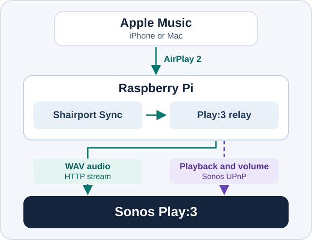

# AirPlay 2 bridge for Sonos Play:3

This project keeps older Sonos speakers useful by bringing them into AirPlay 2.
The Play:3 is the first supported model. A Raspberry Pi makes it appear in
the AirPlay picker, so you can play music, skip tracks, and adjust the
speaker's volume from your iPhone or Mac.



The Pi receives AirPlay through Shairport Sync and relays the audio to the
Play:3 over the network. It streams WAV by default, with FLAC available as an
option.

## Sync with other AirPlay speakers

We ran click tests and tuned the timing to bring the Play:3 closer to another
AirPlay speaker. The gap can still change between tracks, so this works best
for casual listening across rooms. To tune it, set
`audio_backend_latency_offset_in_seconds` in the `general` section of the
Shairport Sync config and restart the services. A negative value moves playback
earlier. [Shairport Sync timing guide](https://github.com/mikebrady/shairport-sync/blob/5.6.3/ADVANCED%20TOPICS/AdjustingSync.md)

## Install on a 64-bit Raspberry Pi

The installer targets Raspberry Pi OS or Debian on ARM64 with systemd. Use a
trusted LAN, reserve IPv4 addresses for the Pi and the Play:3, and ungroup
the Play:3 in the Sonos app before testing.

1. Install the host tools on the Pi.

   ```sh
   sudo apt install avahi-daemon curl ffmpeg python3
   sudo systemctl enable --now avahi-daemon
   ```

2. Run discovery **on the Pi**, then choose the UUID of the one speaker you
   want to expose in AirPlay.

   ```sh
   python3 discover-sonos.py
   python3 discover-sonos.py --select RINCON_00000000000001400 --output relay.env
   ```

   Replace the example UUID with the value from the list. Discovery only
   reads device information. If discovery is unavailable, copy
   `relay.env.example` to `relay.env` and set the Pi IP, speaker IP and speaker
   UUID manually. The UUID appears in the speaker's device description at
   `http://<speaker-ip>:1400/xml/device_description.xml` as the first device's
   `UDN`. Remove the `uuid:` prefix when copying it into `relay.env`.

3. Extract the official [Shairport Sync 5.6.3](https://github.com/mikebrady/shairport-sync/releases/tag/5.6.3)
   ARM64 image. With Docker available for this one-time step, run the
   following in the project directory. Docker is only needed for extraction.

   ```sh
   mkdir receiver-image
   receiver_container=$(docker create --platform linux/arm64 mikebrady/shairport-sync:5.6.3)
   docker export "$receiver_container" | tar -xf - -C receiver-image
   docker rm "$receiver_container"
   ```

4. Download the pinned [upstream relay](https://github.com/shinn-y/airplay2-dlna-bridge/tree/6089a33ae8ffa5020c10a98d30fcaa92e8423eec)
   and install the services. The installer verifies the relay checksum.

   ```sh
   curl -fL https://raw.githubusercontent.com/shinn-y/airplay2-dlna-bridge/6089a33ae8ffa5020c10a98d30fcaa92e8423eec/bridge/server.py -o server.py
   sudo ./install-pi receiver-image server.py relay.env
   ```

5. Select **Sonos Play 3** in Apple Music's AirPlay picker. Play a track,
   adjust volume, then skip to another track. The service starts on boot.

   ```sh
   systemctl is-active play3-airplay-clock play3-airplay-relay play3-airplay-receiver
   journalctl -u play3-airplay-receiver -u play3-airplay-relay
   ```

If another AirPlay receiver or PTP service is already running on the Pi, resolve
the service and port conflicts before installing. To change the AirPlay name or
timing, edit `/opt/play3-airplay/shairport-sync.conf`. The stream and volume
settings live in `/etc/play3-airplay/relay.env`. After either edit, restart with
`sudo systemctl restart play3-airplay-relay play3-airplay-receiver`.

## Contributing

PRs that improve playback on the Play:3 or bring other legacy Sonos models
into AirPlay 2 are welcome. If you've tested on a speaker, share the model,
Sonos software version, and what worked for playback, track changes, and
volume control.

## Credits

Adapted from [airplay2-dlna-bridge](https://github.com/shinn-y/airplay2-dlna-bridge).
AirPlay reception and timing are provided by
[Shairport Sync](https://github.com/mikebrady/shairport-sync) and
[NQPTP](https://github.com/mikebrady/nqptp).
